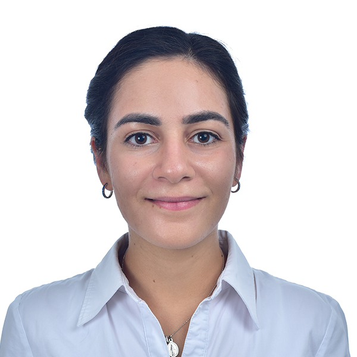

<h1>Theresa Honein</h1>

Assistant Professor at American University of Beirut (AUB) Department of Mechanical Engineering

Email: theresa.honein at aub.edu.lb 
Office: Bechtel 532 
Office Phone: +961-1-340460 / 350000 Ext. 3429

<a href="https://www.youtube.com/@theresahonein" target="_blank">
Subscribe on YouTube
</a>
<a href="https://scholar.google.com/citations?user=_LwpuP4AAAAJ&amp;hl=en" target="_blank">
Google Scholar
</a>

My name is Theresa Honein. I earned my Ph.D. in Mechanical Engineering at the University of California, Berkeley in Summer 2024 under [Professor Oliver O'Reilly](https://me.berkeley.edu/people/oliver-m-oreilly). I am interested in utilizing tools from dynamics and mechanics to create physically accurate simulations of seemingly simple, yet actually difficult to model, phenomena. I have recently been named a fellow for the [Center of Advanced Mathematical Sciences](https://www.aub.edu.lb/cams/Pages/fellows.aspx) at AUB.

<h2>Mechanics of Motion &amp; Dynamics and Data Lab (MoM &amp; DaD Lab)</h2>

The long-term vision of the MoM &amp; DaD Lab is to develop accessible technology capable of producing physically accurate simulations of quasi rigid motion from minimal sensing at low cost. Ultimately, this could enable applications such as mobile tools that teach motor skills ranging from bicycle riding to correct padel technique using only video data, for example. Such technology would deepen our understanding of dynamic phenomena, improve motion diagnosis and optimization, and generate high quality datasets for training future machine learning models.

<!-- 

 -->
<!--  -->
<!--  -->
<!--  -->
<!-- 
 -->

<a href="people">Meet the lab members →</a> &nbsp;·&nbsp; We are recruiting undergraduate and M.S. students. <a href="people#join-our-research-group">Learn how to join.</a>

