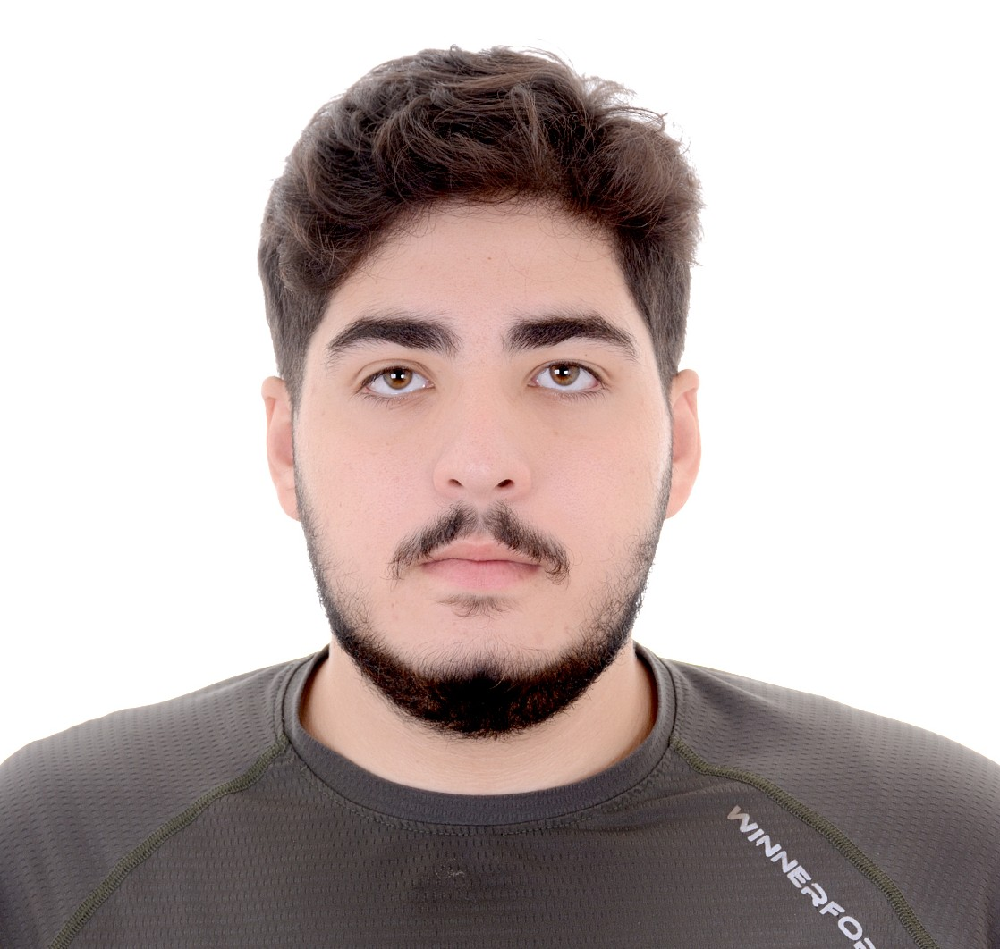
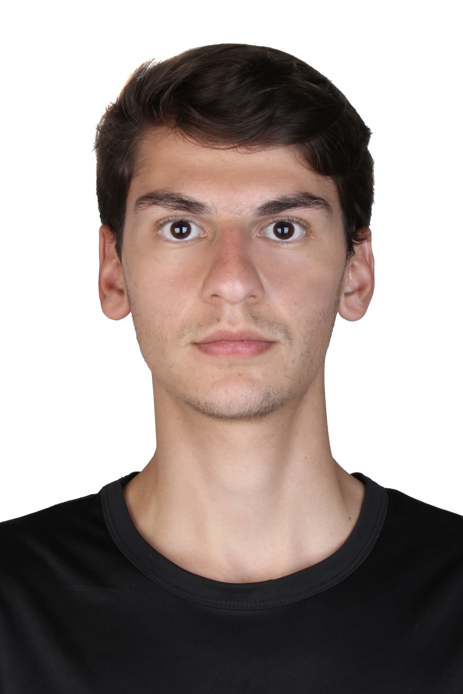
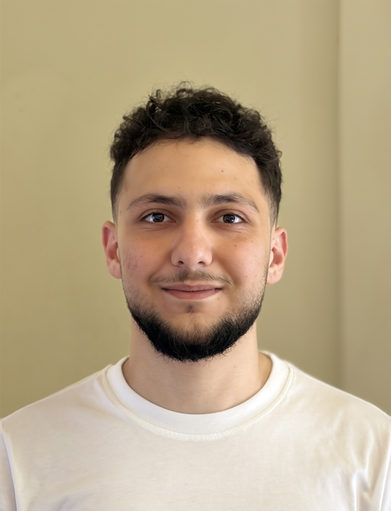

# People

## Graduate Students

<h3>Karim Braidi</h3>

Email: kab30 at mail.aub.edu

My name is Karim Braidi. I am a graduate student at the American University of Beirut (AUB) working under the supervision of Dr. Theresa Honein. My research interests are rigid body dynamics and multibody systems, with a focus on analytical and numerical formulations. I’m particularly interested in data-driven modeling approaches for dynamical systems, including reduced-order modeling and integration of machine learning techniques in classical mechanics.

<h3>Elissa Ephrem</h3>

Email: eee19 at mail.aub.edu · <a href="https://www.linkedin.com/in/elissa-ephrem-4850ab2b5/" target="_blank">LinkedIn</a>

I am a Mechanical Engineer and Master's candidate in Mechanical Engineering at AUB, with practical experience spanning manufacturing, automotive engineering, research, product development, and industrial operations. My engineering journey has provided me with diverse exposure through internships and technical experiences with organizations including Mitsulift, Mercedes-Benz, Maserati, Bassoul-Heneine (BMW Distributor), and INDEVCO.

## Undergraduate Students

<h3>Wafic Itani</h3>

Email: woi00 at mail.aub.edu

My name is Wafic Itani, and I am a second-year mechanical engineering undergraduate student at AUB. I am passionate about motorsports, vehicle dynamics, and dynamics in general, with a strong interest in understanding and improving the motion of mechanical systems. I approach challenges with curiosity and persistence, always eager to push myself to learn new concepts and expand my skills. I enjoy working in collaborative environments where ideas are exchanged openly, and I value the process of turning theoretical knowledge into practical, real-world applications.

<h3>Maykel Tohme</h3>

Email: mit12 at mail.aub.edu

I am currently a second year Mechanical Engineering undergraduate student at the American University of Beirut, motivated through an appreciation of dynamics, fluid mechanics, and aerodynamics. I aim to bridge the gap between theory and high-performing engineering.
At the moment, I am part of the Baja SAE Suspension Subteam at my university working on optimizing vehicle components for off-road durability. I am developing expertise in simulation and analysis through Finite Element Analysis (FEA) for structural verification and Computational Fluid Dynamics (CFD) for flow analysis. These abilities come from practical experience in the construction of autonomous robots and customized unmanned aerial vehicles using Solidworks, Arduino, and various sensors.

<h3>Haroun El Bouz</h3>

Email: hbe06 at mail.aub.edu

I am a second-year Mechanical Engineering undergraduate student at AUB, driven by a strong interest in mechatronics, robotics, and dynamics. I am particularly passionate about bridging the gap between computational simulations and physical reality. I constantly challenge myself by exploring advanced concepts, and I place high value on turning theoretical ideas into simulation models and physical experiments to validate computational predictions directly against real-world results.

<h2 id="join-our-research-group">Join our research group!</h2>

I am currently recruiting motivated undergraduate and M.S. students to join my research team. Our work focuses on reproducing the accurate dynamics of the human body using motion capture technologies.

Requirements:

- Interest in dynamics, motion analysis, biomechanics or related fields
- Dedication to hands-on and computational research

To Apply:
Please send the following to theresa.honein at aub.edu.lb:

- Unofficial Transcript
- Resume
- Brief Letter of Intent (outlining your interest and any relevant experience)

Join us in advancing our understanding of human body dynamics!

